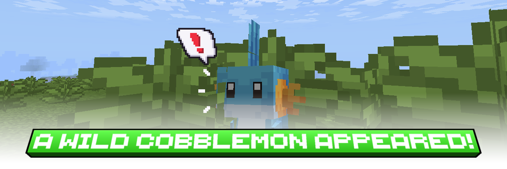

<center>
  
</center>

A Minecraft mod!

<a href="https://ko-fi.com/matilabo"></a>
&nbsp;
<a href="https://modrinth.com/project/a-wild-cobblemon-appeared/"></a>
&nbsp;
<a href="https://www.curseforge.com/minecraft/mc-mods/a-wild-cobblemon-appeared"></a>


To report an issue, check the [Issues tab](https://github.com/Matilabo/cobblemon-wild-zones/issues).

# A Wild Cobblemon Appeared!

A Fabric mod for Cobblemon 1.8 (Minecraft 1.21.1) that adds a way to make **Wild Zones**, which have a chance to trigger encounter events when a player walks on them and starts a battle with a wild Cobblemon, like the tall grass of the games.
It can also have a chance to play the event while walking on **any set block** (like grass,tall grass, etc) or before **every wild battle**, or once every time a player enters a **new biome**. Everything is highly customizable!

Requires the **Cobblemon 1.8 or 1.8.1** mod. Compatible with other mods such as Cobblemon Repel, Mega Showdown, and any mod or datapack that adds Pokémon to Minecraft like AllTheMons and Missingmons.

## Installing

Drop `awildencounter-<version>.jar` into `mods/` alongside:

- Fabric Loader 0.17.2 or newer
- Fabric API 0.116.6+1.21.1 or newer
- Cobblemon 1.8.1
- Java 21

The mod works on both sides. Install it on the client **and** the server: the server enforces
every rule, and the client is what draws the config menu and plays the cutscene. A client without
it can still play but cannot open the menu, the admins can configure the mod and set zones from the
console instead.

## Building

From the repository root:

```bash
./gradlew build
```

The jar is built in `build/libs/awildencounter-<version>.jar`.

Gradle downloads its own JDK 21 into `~/.gradle/jdks` and
compiles with any `java -version` locally. Cobblemon comes from its own Maven
as a compile-only dependency.

## License

Released under the Mozilla Public License 2.0. See [LICENSE](LICENSE).
